<p align="center">
  
</p>

<p align="center">
  <a href="https://github.com/KeynnerXe"></a>
  <a href="https://keynnerxe.github.io/"></a>
  
</p>

<p align="center">
  <code>Transformando ideas en código y código en soluciones reales.</code>
</p>


## `01` &nbsp;›&nbsp; whoami <sub>— sobre mí</sub>

```js
// keynner.config.js
export default {
  nombre:    "Keynner Ramos",
  alias:     "KeynnerXe",
  rol:       "Desarrollador de Software",
  base:      "Colombia",
  enfoque:   ["desarrollo web", "backend & APIs", "bases de datos",
              "automatización", "ingeniería de software"],
  filosofia: "aprender construyendo",
};
```

> Soy estudiante de desarrollo de software y desarrollador de proyectos tecnológicos. Me interesa crear aplicaciones útiles, integrar servicios, diseñar bases de datos y encontrar soluciones eficientes a problemas reales.
>
> Disfruto aprender nuevas tecnologías, experimentar con ideas y entender cómo funcionan los sistemas desde dentro. Mi objetivo es seguir creciendo como desarrollador y construir productos que tengan un impacto más allá del código.


## `02` &nbsp;›&nbsp; stack --list <sub>— tecnologías</sub>

<div align="center">
<table>
  <tr>
    <td align="right"><code>lenguajes</code></td>
    <td></td>
  </tr>
  <tr>
    <td align="right"><code>web</code></td>
    <td></td>
  </tr>
  <tr>
    <td align="right"><code>datos &amp; tools</code></td>
    <td></td>
  </tr>
</table>
</div>


## `03` &nbsp;›&nbsp; ls ./proyectos <sub>— lo que he construido</sub>

<table>
  <tr>
    <td width="50%" valign="top">
      <sub><code>[ P.01 ]</code></sub>
      <h3><a href="https://ctg.hoops.co">CTG HOOPS</a></h3>
      <p>Proyecto relacionado con la comunidad del baloncesto en Cartagena.</p>
      <p><code>comunidad</code> <code>baloncesto</code> <code>presencia digital</code></p>
      <a href="https://ctg.hoops.co"><b>ctg.hoops.co ↗</b></a>
    </td>
    <td width="50%" valign="top">
      <sub><code>[ P.02 ]</code></sub>
      <h3><a href="https://gammatechlab.com">GammaTechLab</a></h3>
      <p>Proyecto tecnológico enfocado en el entorno digital y el desarrollo de soluciones.</p>
      <p><code>tecnología</code> <code>desarrollo</code> <code>innovación</code></p>
      <a href="https://gammatechlab.com"><b>gammatechlab.com ↗</b></a>
    </td>
  </tr>
  <tr>
    <td width="50%" valign="top">
      <sub><code>[ P.03 ]</code></sub>
      <h3><a href="https://funmiador.org">Funmiador</a></h3>
      <p>Proyecto con presencia web propia.</p>
      <p><code>desarrollo</code> <code>soluciones digitales</code></p>
      <a href="https://funmiador.org"><b>funmiador.org ↗</b></a>
    </td>
    <td width="50%" valign="top">
      <sub><code>[ P.04 ]</code></sub>
      <h3><a href="https://keynnerxe.github.io/">Mi portafolio</a></h3>
      <p>Un espacio para conocer mi perfil, mi trabajo y los proyectos que desarrollo.</p>
      <p><code>trayectoria</code> <code>proyectos</code> <code>perfil profesional</code></p>
      <a href="https://keynnerxe.github.io/"><b>keynnerxe.github.io ↗</b></a>
    </td>
  </tr>
</table>


## `04` &nbsp;›&nbsp; git log --stats <sub>— actividad</sub>

<p align="center">
  
  
</p>

<p align="center">
  
</p>


## `05` &nbsp;›&nbsp; tail -f ahora.log <sub>— en qué estoy trabajando</sub>

```bash
$ tail -f ahora.log
[en curso]  mejorando mis habilidades de frontend y backend
[en curso]  diseñando arquitecturas de software más sólidas
[en curso]  profundizando en bases de datos y optimización de consultas
[en curso]  creando integraciones con APIs y servicios externos
[en curso]  desarrollando proyectos que resuelven necesidades reales
▌
```


## `06` &nbsp;›&nbsp; cat fuera_del_codigo.txt <sub>— más allá del código</sub>

<table>
  <tr>
    <td>🏀 <b>Baloncesto</b></td>
    <td>🏐 <b>Voleibol</b></td>
  </tr>
  <tr>
    <td colspan="2">
      Ambos me han enseñado que mejorar requiere <b>disciplina</b>, <b>estrategia</b>, <b>constancia</b> y aprender de los errores. Esa misma mentalidad se aplica al desarrollo de software: cada problema es una oportunidad para mejorar la siguiente solución.
    </td>
  </tr>
</table>

<br/>

<p align="center">
  
  <br/><br/>
  <a href="https://keynnerxe.github.io/"></a>
</p>
